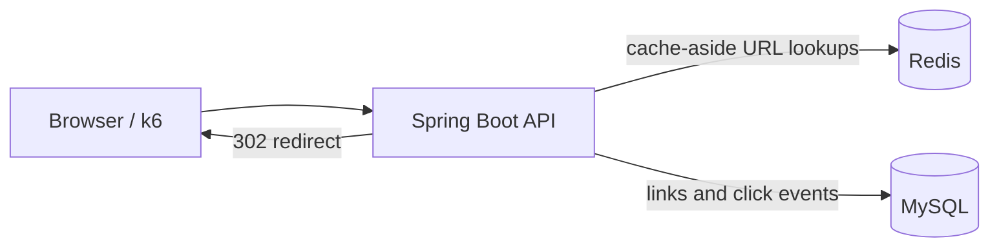

# URL Shortener

A small Java 17 URL shortener that stores links in MySQL, uses Redis for redirect caching and fixed-window rate limits, and records click analytics. The project uses one Spring Boot application and one plain HTML page.

## Architecture



## Tech stack

- Java 17, Spring Boot 3, Maven
- Spring Web, Spring Data JPA, Spring Data Redis, Validation
- MySQL 8 and Redis 7
- Plain HTML, CSS, and JavaScript
- Docker Compose, Docker, and k6

## API

### Shorten a URL

```bash
curl -X POST http://localhost:8080/api/shorten \
  -H "Content-Type: application/json" \
  -d '{"longUrl":"https://example.com/a-page","customAlias":"my-page","expiryDays":30}'
```

Returns `shortCode`, `shortUrl`, and `expiresAt`. The alias and expiry are optional. Invalid URLs return 400, duplicate aliases return 409, and requests over the limit return 429.

### Redirect

```bash
curl -i http://localhost:8080/my-page
```

Returns a 302 response and records the click, referrer, and broad device type. An expired short link returns 410; an unknown code returns 404.

### Link analytics

```bash
curl http://localhost:8080/api/stats/my-page
```

Returns the original URL, total clicks, clicks grouped by day, up to five top referrers, and a device breakdown.

### Cache analytics and health

```bash
curl http://localhost:8080/api/stats
curl http://localhost:8080/health
```

The health endpoint responds with plain text `OK`.

## Configuration

Set these environment variables for hosted services. The defaults below are for local development.

| Variable | Local default | Purpose |
| --- | --- | --- |
| `DB_URL` | `jdbc:mysql://localhost:3306/url_shortener?createDatabaseIfNotExist=true&useSSL=false&allowPublicKeyRetrieval=true&serverTimezone=UTC` | JDBC URL |
| `DB_USER` | `shortener` | MySQL username |
| `DB_PASS` | `shortener` | MySQL password |
| `REDIS_HOST` | `localhost` | Redis host |
| `REDIS_PORT` | `6379` | Redis port |
| `REDIS_PASSWORD` | empty | Redis password |
| `REDIS_SSL` | `false` | Set `true` for TLS Redis services such as Upstash |
| `BASE_URL` | `http://localhost:8080` | Public base URL included in generated links |
| `CACHE_ENABLED` | `true` | Toggle URL caching for comparison runs |

For Render, set `PORT` if needed; Spring Boot reads it automatically. Point `DB_URL`, `DB_USER`, and `DB_PASS` at MySQL (for example Aiven). Point Redis variables at the Redis endpoint and set `REDIS_SSL=true` for Upstash TLS.

## Run locally

Use PowerShell from the project root. Docker Compose starts MySQL and Redis; run the app with Maven in a second terminal.

```powershell
docker compose up -d
$env:DB_URL = "jdbc:mysql://localhost:3306/url_shortener?createDatabaseIfNotExist=true&useSSL=false&allowPublicKeyRetrieval=true&serverTimezone=UTC"
$env:DB_USER = "shortener"
$env:DB_PASS = "shortener"
$env:REDIS_HOST = "localhost"
$env:REDIS_PORT = "6379"
$env:REDIS_PASSWORD = ""
$env:BASE_URL = "http://localhost:8080"
$env:CACHE_ENABLED = "true"
mvn spring-boot:run
```

Open [http://localhost:8080](http://localhost:8080). Stop the app with Ctrl+C, then stop local services with `docker compose down` (add `-v` only if you also want to remove the MySQL data volume).

## Build order and run commands

These steps describe the intended implementation sequence. Commands are cumulative; run them from the project root, with a separate terminal for the app when indicated.

1. **Project setup, Compose, entities, and base62.** Start dependencies and compile the project:

   ```powershell
   docker compose up -d
   mvn compile
   ```

2. **Shorten, redirect, and track clicks.** Start the application after configuring the local environment as shown in [Run locally](#run-locally), then try the API:

   ```powershell
   mvn spring-boot:run
   curl.exe -X POST http://localhost:8080/api/shorten -H "Content-Type: application/json" -d '{"longUrl":"https://example.com"}'
   curl.exe -i http://localhost:8080/1
   ```

3. **Redis cache and hit/miss stats.** Keep Redis running, use `CACHE_ENABLED=true`, restart the app, follow a short link twice, and inspect counters:

   ```powershell
   $env:CACHE_ENABLED = "true"
   mvn spring-boot:run
   curl.exe -i http://localhost:8080/1
   curl.exe -i http://localhost:8080/1
   curl.exe http://localhost:8080/api/stats
   ```

4. **Rate limit, aliases, expiry, and validation.** Restart with the local configuration, then create a link using optional fields:

   ```powershell
   mvn spring-boot:run
   curl.exe -X POST http://localhost:8080/api/shorten -H "Content-Type: application/json" -d '{"longUrl":"https://example.com","customAlias":"example-1","expiryDays":7}'
   ```

5. **Analytics and frontend.** Start the app and open the page; use its stats section or:

   ```powershell
   mvn spring-boot:run
   curl.exe http://localhost:8080/api/stats/example-1
   ```

6. **Load test and deployment image.** With the app already running and k6 installed, test redirects. Build the app image with Docker:

   ```powershell
   k6 run -e BASE_URL=http://localhost:8080 loadtest/redirect.js
   docker build -t url-shortener .
   ```

The k6 setup creates 100 links and waits between batches to respect the API's 20-per-minute rate limit. Its redirect phase runs for 30 seconds with 50 virtual users.

## Design decisions

- **Base62:** database IDs are compactly represented with URL-safe digits and letters; saving first gives every generated link a unique ID without random collision retries.
- **Redis:** repeated redirects can avoid a MySQL read, and Redis counters provide cache and rate-limit metrics.
- **302 instead of 301:** temporary redirects are not permanently cached by browsers, so each visit reaches the app and can be counted.
- **Cache-aside:** the app checks Redis, reads MySQL on a miss, and then stores the result. The database remains the source of truth.
- **Fixed-window rate limiting:** one Redis counter per IP and minute is easy to explain and implement with `INCR` plus `EXPIRE`; its tradeoff is a possible burst at a window boundary.
- **Click analytics:** each redirect increments the URL total and stores a small click row for daily, referrer, and device summaries.

## Load test results

Run the same test once with `CACHE_ENABLED=false` and again with `CACHE_ENABLED=true`. Restart the app between runs so each run uses the selected setting. Fill in the measurements from your own environment.

| Cache | Requests/sec | p95 latency (ms) |
| --- | ---: | ---: |
| OFF |  |  |
| ON |  |  |

## Live demo

Live demo: **[Add deployed URL here]**
